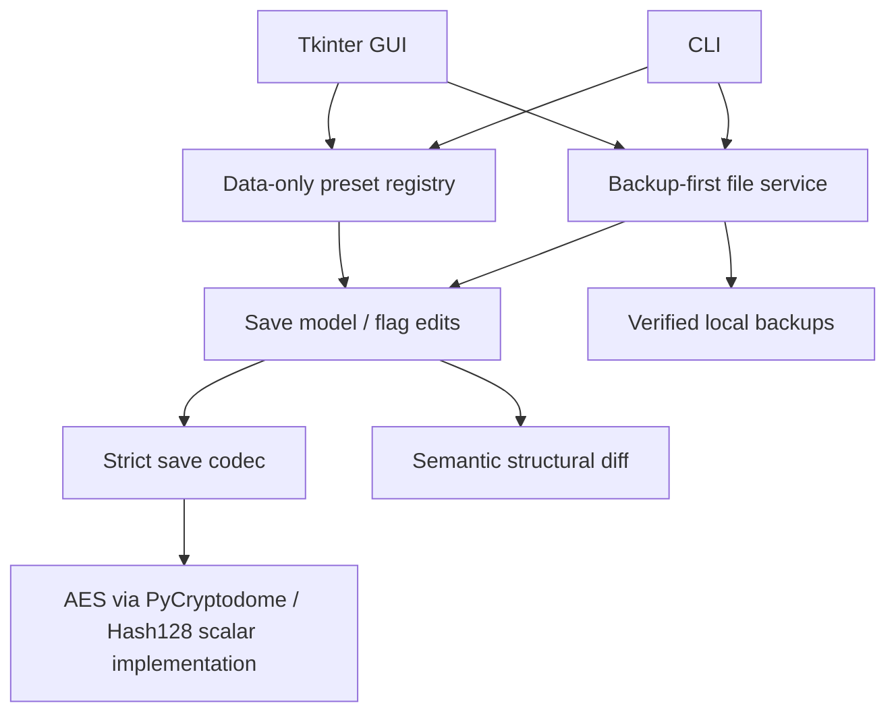

# Architecture

The desktop GUI and CLI both call the same Python service. No web server or external service is involved.
Tkinter keeps the Windows distribution small and avoids a separate browser runtime; PyInstaller bundles Python/Tk for players.

| Module | Responsibility |
| --- | --- |
| `codec.py`, `hash128.py`, `profiles.py` | Bounded framing, strict JSON, integrity, encryption, verified build policy |
| `model.py` | FELD dictionaries, item queries, span-preserving boolean edits, semantic readback invariants |
| `diff.py` | Added/removed/changed state with named flag IDs and category/search filters |
| `registry.py`, `data/` | Known flag meanings and declarative, preconditioned presets |
| `service.py` | Stable source snapshots, backups, exclusive exports, consent-gated one-file apply/restore |
| `discovery.py` | Standard Windows save path and process enumeration |
| `gui.py`, `cli.py` | User interaction; no serialization or quest implementations |
| `demo.py`, `tests/` | Synthetic fixtures, hidden GUI smoke and automated safety checks |

No codec function writes files. No preset describes binary offsets or invokes code.
The patch engine accepts existing boolean flags only. Semantic invariants cover the entire outer document and nested FELD state.
The UI runs long read/encode/diff work on one background worker at a time and handles UI updates on the Tk thread.

The supported build profile is explicit; checksum/decryption success alone does not authorize editing unknown builds.
This release does not edit counters, inventory, positional data, encrypted files with unknown framing or multiple originals at once.
